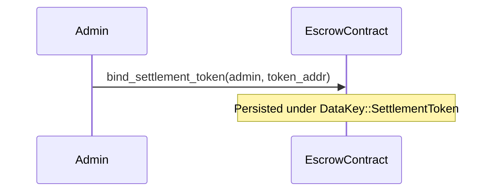
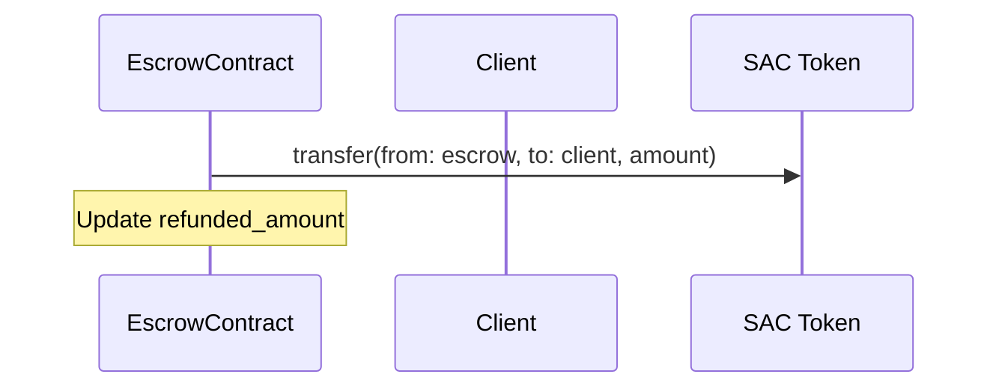

# Escrow Settlement Token Flow

This document details the design, life cycle, and security model of the on-chain settlement token transfers implemented for the TalentTrust Escrow contract.

## Overview

Historically, the Escrow contract only tracked milestone funding state using integer counters, without performing real on-chain token moves. This implementation updates the contract lifecycle to wire a configurable Stellar Asset Contract (SAC) token. 

All funds deposited are held directly in the contract address, and payouts (releases, refunds, dispute resolutions, and mutual settlements) move these real token balances atomically with the contract state updates.

---

## Token Flow Lifecycle

### 1. Initialization & Configuration
- **Admin Setup**: The contract administrator configures the settlement token address using `bind_settlement_token(admin: Address, token: Address)` (or deprecated delegate `set_settlement_token`).
- **Key Storage**: The token contract address is stored under the `DataKey::SettlementToken` persistent storage key with extended TTL.



### 2. Deposit Funds
- **Action**: Client calls `deposit_funds(contract_id, caller, amount)`.
- **Validation**: Verifies that the caller is indeed the client and validates the amount.
- **Token Transfer**: Pulls the specified amount of tokens from the client's wallet to the Escrow contract's address:
  `token::Client::transfer(&client, &escrow_address, &amount)`
- **Safety**: `client.require_auth()` ensures only the legitimate client can authorize the transfer.
- **Settlement Invalidation**: Any successful deposit deletes any outstanding settlement proposal (`DataKey::Settlement(id)`) so that a proposed amount always refers to the current balance.

```mermaid
sequenceDiagram
    participant Client
    participant EscrowContract
    participant SAC Token
    Client->>EscrowContract: deposit_funds(contract_id, client, amount)
    EscrowContract->>SAC Token: transfer(from: client, to: escrow, amount)
    Note over EscrowContract: Update funded_amount & total_deposited; del Settlement(id)
```

### 3. Milestone Release
- **Action**: Authorized party (e.g. client) calls `release_milestone(contract_id, milestone_index, caller)`.
- **Validation**: Verifies that the milestone is approved, funded, and not already released or refunded.
- **Token Transfer**: Pushes the milestone amount from the contract address to the freelancer:
  `token::Client::transfer(&escrow_address, &freelancer, &milestone_amount)`
- **Error Handling**: Fails with `InsufficientEscrowBalance` if the contract does not hold enough tokens.
- **Settlement Invalidation**: Any successful release deletes any outstanding settlement proposal (`DataKey::Settlement(id)`).

```mermaid
sequenceDiagram
    participant EscrowContract
    participant Freelancer
    participant SAC Token
    EscrowContract->>SAC Token: transfer(from: escrow, to: freelancer, amount)
    Note over EscrowContract: Update released_amount; del Settlement(id)
```

### 4. Milestone Refund
- **Action**: Client or arbiter initiates a refund request using `refund_unreleased_milestones(contract_id, milestone_indices)`.
- **Validation**: Verifies milestones are not already released/refunded.
- **Token Transfer**: Pushes the calculated refund sum from the contract address back to the client:
  `token::Client::transfer(&escrow_address, &client, &refund_amount)`
- **Error Handling**: Fails with `InsufficientEscrowBalance` if the contract balance is insufficient.



### 5. Dispute Resolution
- **Action**: Arbiter calls `resolve_dispute(contract_id, caller, resolution)`.
- **Validation**: Verifies caller is the arbiter and contract is in `Disputed` status.
- **Token Transfer**: Calculates payouts for both client and freelancer according to the resolution. Performs transfers atomically:
  - Transfers `freelancer_payout` to the freelancer.
  - Transfers `client_payout` to the client.
- **Error Handling**: Verifies the escrow balance before executing transfers, failing with `InsufficientEscrowBalance` if insufficient.

### 6. Mutual Settlement (Two-Party Agreement)
A two-signature proposal/accept flow allows the client and freelancer to close the contract at an agreed split without involving the admin. It is available in `Created`, `Funded`, and `Disputed` statuses.

- **Propose**: Either party calls `propose_settlement(contract_id, proposer, freelancer_amount)`.
  - Requires the proposer's authorization and confirms they are a party to the contract.
  - Requires `0 <= freelancer_amount <= funded - released`, else `InvalidAmount`.
  - Stores `DataKey::Settlement(id) -> { proposer, freelancer_amount, created_at }`, replacing any earlier proposal.
  - Emits event `("settle_p", id) -> (proposer, freelancer_amount)`.
- **Accept**: The counterparty calls `accept_settlement(contract_id, acceptor, freelancer_amount)`.
  - Must be the *other*party (self-accept is rejected).
  - Must echo the same `freelancer_amount` as the stored proposal, else `SettlementMismatch`. This prevents a proposer from swapping the amount between the counterparty's signing and execution.
  - Pays the freelancer `freelancer_amount` and the client the remaining held balance, sets status to `Resolved`, and deletes the proposal.
  - Emits event `("settled", id) -> (to_freelancer, to_client)`.
- **Withdraw**: The proposer can remove their own proposal via `withdraw_settlement(contract_id, proposer)`.
- **Invalidation**: Any `deposit_funds` or `release_milestone` after a proposal deletes the proposal, so the amount always refers to the current balance.
- **Read**: `get_settlement(contract_id)` returns the active proposal, if any.

```mermaid
sequenceDiagram
    participant Client
    participant Freelancer
    participant EscrowContract
    participant SAC Token
    Client->>EscrowContract: propose_settlement(id, client, freelancer_amount)
    Note over EscrowContract: Store Settlement(id); emit ("settle_p", id)
    Freelancer->>EscrowContract: accept_settlement(id, freelancer, freelancer_amount)
    EscrowContract->>SAC Token: transfer(from: escrow, to: freelancer, freelancer_amount)
    EscrowContract->>SAC Token: transfer(from: escrow, to: client, remaining)
    Note over EscrowContract: status = Resolved; del Settlement(id); emit ("settled", id)
```

### 7. Contract Interface Summary

| Function | Authorization | Description |
|----------|---------------|-------------|
| `propose_settlement(id, proposer, freelancer_amount)` | Proposer | Create/replace a mutual settlement proposal. |
| `accept_settlement(id, acceptor, freelancer_amount)` | Counterparty | Accept the proposal, echoing the amount, and pay both sides. |
| `withdraw_settlement(id, proposer)` | Proposer | Remove the proposer settlement. |
| `get_settlement(id)` | Any | Read the active settlement proposal. |

### 8. Errors and Events

New error variants are appended to the end of `EscrowError` (never renumbered):

| Error | Description |
|-------|-------------|
| `SettlementMismatch` | The accepted amount does not match the stored proposal, or the acceptor is not the counterparty. |

Events:

| Event | Payload |
|-------|---------|
| `(settle_p, id)` | `(proposer, freelancer_amount)` |
| `(settled, id)` | `(to_freelancer, to_client)` |

---

## Threat Model & Security Mitigations

| Threat | Mitigation |
|--------|------------|
| **Unauthorized Payouts / Theft** | Every transfer from the client's wallet requires explicit cryptographic authorization via `.require_auth()`. Contract-held payouts (release/refund/dispute/settlement) are strictly gated by access control roles stored in contract state. Mutual settlement requires both parties' authorization. |
| **Double Payouts / Reentrancy** | Milestone state transitions are locked with boolean flags (`released` and `refunded`). Any attempt to release or refund a milestone twice will panic early. Settlement sets the contract to `Resolved` and deletes the proposal atomically with the payouts. |
| **Fund Lock-up / Under-funded Transfers** | Added `InsufficientEscrowBalance` check to ensure the contract fails loudly before attempting to transfer more than its balance, keeping the state intact. Settlement amounts are bounded by `funded - released`. |
| **Amount Swap Between Signing and Execution** | The acceptor must echo the same `freelancer_amount` as the stored proposal; a mismatch fails with `SettlementMismatch`. Any deposit or release invalidates the proposal. |
| **Arithmetic Overflow/Underflow** | All balance calculations use safe arithmetic wrappers (`safe_add_amounts`, `safe_subtract_amounts`) preventing overflow exploits. |
